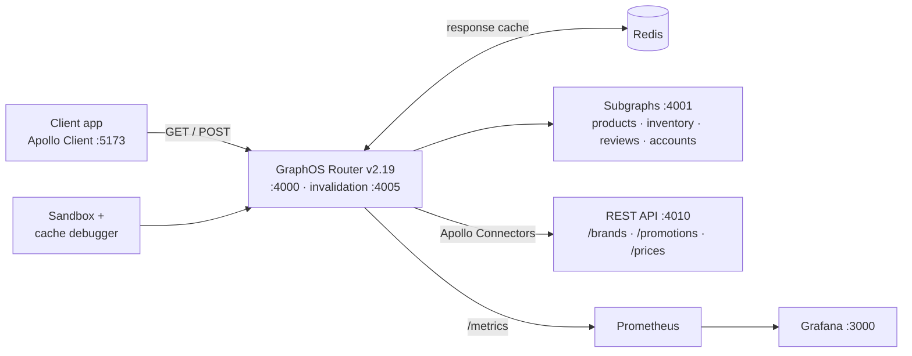

# Apollo Router Response Caching Demo

A hands-on reference for **response caching in GraphOS Router v2.19**, covering GraphQL subgraphs and Apollo Connectors (REST). Each feature is a runnable scenario that prints PASS/FAIL, so you can use the repo as a live demo, a learning path, or a regression check before a Router upgrade.

```
docker compose up -d --build     # everything runs in Docker
./scripts/run-all.sh             # 12 scenarios, ~2.5 minutes
```

## What's inside



| Origin | Caching behavior it demonstrates |
|---|---|
| `products` subgraph | root fields (60s), entities (300s), `@cacheTag`, `no-store` field, error field, mutation that invalidates |
| `inventory` subgraph | short-lived entity data (10s): lowest TTL wins |
| `reviews` subgraph | `Cache-Control: public` without `max-age` → Router fallback TTL (45s) |
| `accounts` subgraph | `PRIVATE` data cached per user via `private_id` |
| `catalog` connector | REST TTL from headers, no-header fallback, entity connector, `cache_key_headers`, scoped invalidation |

## Quickstart

**Prerequisites:** Docker, `curl`, `jq`, and a GraphOS graph API key (response caching is a GraphOS Router feature; Free and Developer plans work, with rate limits).

```bash
cp .env.example .env            # add APOLLO_KEY, APOLLO_GRAPH_REF and two invalidation secrets
docker compose up -d --build
curl -s localhost:8088/health   # {"status":"UP"}
./scripts/run-all.sh
```

| URL | What |
|---|---|
| http://localhost:4000 | Apollo Sandbox (enable the **cache debugger** in settings) |
| http://localhost:5173 | Client app: which cache layer answered |
| http://localhost:3000 | Grafana "Response Cache" dashboard |
| http://localhost:5540 | RedisInsight: browse `demo:*` keys (connect to `redis:6379`) |
| http://localhost:4001/__stats | Subgraph call counters |
| http://localhost:4010/__stats | REST API call counters |

## Scenarios

| # | Scenario | Shows |
|---|---|---|
| 01 | [Root field caching](scenarios/01-root-field-caching) | root fields cached as a unit; keyed by query + variables |
| 02 | [Entity caching](scenarios/02-entity-caching) | per-entity reuse and partial hits (plus an operation-name gotcha) |
| 03 | [Mixed TTLs](scenarios/03-mixed-ttls) | parts expire independently; the client gets the lowest TTL |
| 04 | [Fallback TTL](scenarios/04-fallback-ttl) | where TTLs come from when the origin gives no `max-age` |
| 05 | [Never cached](scenarios/05-not-cached) | `no-store`, errors, mutations, Apollo Server defaults |
| 06 | [Private data](scenarios/06-private-data) | `scope: PRIVATE` + `private_id`, per-user entries |
| 07 | [Client cache control](scenarios/07-client-cache-control) | client `Cache-Control`, `Cache-Tag` for CDNs, GET requests |
| 08 | [Cache debugger](scenarios/08-cache-debugger) | Sandbox debugger and the `apollo-cache-debugging` header |
| 09 | [Invalidation](scenarios/09-invalidation) | by tag, type and subgraph; mutation-driven invalidation |
| 10 | [Connector caching](scenarios/10-connector-caching) | REST TTLs from headers, entity connectors, no-header fallback |
| 11 | [Connector cache keys](scenarios/11-connector-cache-keys) | `cache_key_headers`, connector invalidation scope and key |
| 12 | [Observability](scenarios/12-observability) | metrics, Prometheus queries, Grafana dashboard |

Run one: `./scenarios/03-mixed-ttls/run.sh`

## Cheat sheet

**TTL**
* Subgraphs: the `max-age` from `Cache-Control` (Apollo Server derives it from `@cacheControl`). No `max-age` → the configured `ttl`. No header at all → not cached.
* Connectors: the REST API's `Cache-Control`. No header at all → cached for `ttl`, but the client gets `no-store`.
* Client response: the **lowest remaining** TTL of every part. Any `private` part → `private`. Any uncacheable part → `no-store`.

**Cache keys**
* Root fields: the full subgraph query + variables (+ private id, + custom key context).
* Entities: per representation, plus the subgraph query, which includes the generated operation name (scenario 02).
* Connectors: also the values of the headers in `cache_key_headers`.

**Never cached:** mutations, responses with errors, `no-store` / `max-age=0`, private data without a `private_id`.

**Invalidation:** `POST :4005/invalidation` with `kind` = `cache_tag` | `type` | `subgraph` (subgraphs) or `cache_tag` (`sources`) | `type` (`source`) | `connector` (connectors). Separate shared keys per scope.

## Repository layout

```
router/
  router.yaml            every response_cache setting, commented by scenario
  supergraph.yaml        composition config (federation 2.14, connect v0.4)
  supergraph.graphql     composed schema (committed, regenerate with scripts/compose-supergraph.sh)
  rhai/main.rhai         private_id from x-user-id + x-response-cache headers
subgraphs/               4 Apollo Server 5 subgraphs in one Node process, with /__stats
connectors/catalog.graphql   Apollo Connectors schema over rest-api/
rest-api/                Express REST mock with per-endpoint Cache-Control, with /__stats
client/                  Vite + React + Apollo Client 4
observability/           Prometheus scrape config + provisioned Grafana dashboard
scenarios/NN-*/          README.md + run.sh per scenario
scripts/                 lib.sh (helpers), run-all.sh, compose-supergraph.sh
```

## Changing things

* **Schema change:** edit the schema, run `./scripts/compose-supergraph.sh` (needs [Rover](https://www.apollographql.com/docs/rover/getting-started)), then `docker compose up -d --build subgraphs`. The Router hot-reloads the new supergraph.
* **Router config or Rhai:** edit `router/`. The Router hot-reloads.
* **Router version:** change the image tag in `docker-compose.yaml` and run `./scripts/run-all.sh` to catch behavior changes.

## Gotchas found while building this

1. **Entity entries are scoped to the operation name** (Router v2.19). Subgraph operations are named `<ClientOp>__<subgraph>__<n>`, and that text is part of the entity cache key, so differently named client operations don't share entity entries. See scenario 02.
2. **Apollo Server object fields default to `maxAge: 0`.** One un-hinted object field (`Product.brand`) made every product query `no-store`. Fix: `@cacheControl(inheritMaxAge: true)`.
3. **Entity contributions need a type-level hint** (`type Product @key(...) @cacheControl(maxAge: 10)`), because `_entities` returns a union.
4. **`x-response-cache` (Rhai) can't see connectors.** Use the debugger or metrics for connector sources.
5. **GET requests need `apollo-require-preflight`** (or another non-simple header). Otherwise the Router's CSRF protection returns 400.

## Production checklist

- [ ] `debug: false`
- [ ] Invalidation endpoint on an internal network only; strong secrets from a secret manager
- [ ] `private_id` from a verified JWT claim, not a header
- [ ] `cache_key_headers` reviewed for every connector source that forwards headers
- [ ] Explicit `max-age` on everything you want cached; `ttl` as an upper bound
- [ ] Redis sized and monitored (`fetch_timeout`, `insert_timeout`, `pool_size`, `required_to_start`)
- [ ] Hit-ratio and Redis-latency alerts (see the Grafana dashboard)

## References

* [Response caching overview](https://www.apollographql.com/docs/graphos/routing/performance/caching/response-caching/overview)
* [Quickstart](https://www.apollographql.com/docs/graphos/routing/performance/caching/response-caching/quickstart) · [Invalidation](https://www.apollographql.com/docs/graphos/routing/performance/caching/response-caching/invalidation) · [Customization](https://www.apollographql.com/docs/graphos/routing/performance/caching/response-caching/customization) · [Observability](https://www.apollographql.com/docs/graphos/routing/performance/caching/response-caching/observability)
* [Response caching for Connectors](https://www.apollographql.com/docs/graphos/routing/performance/caching/response-caching/connectors) · [CDN invalidation](https://www.apollographql.com/docs/graphos/routing/performance/caching/response-caching/cdn-invalidation) · [FAQ](https://www.apollographql.com/docs/graphos/routing/performance/caching/response-caching/faq)
